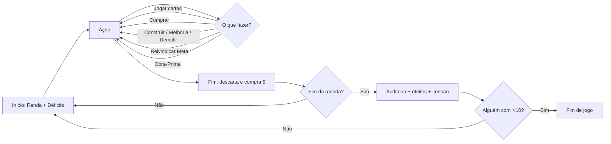
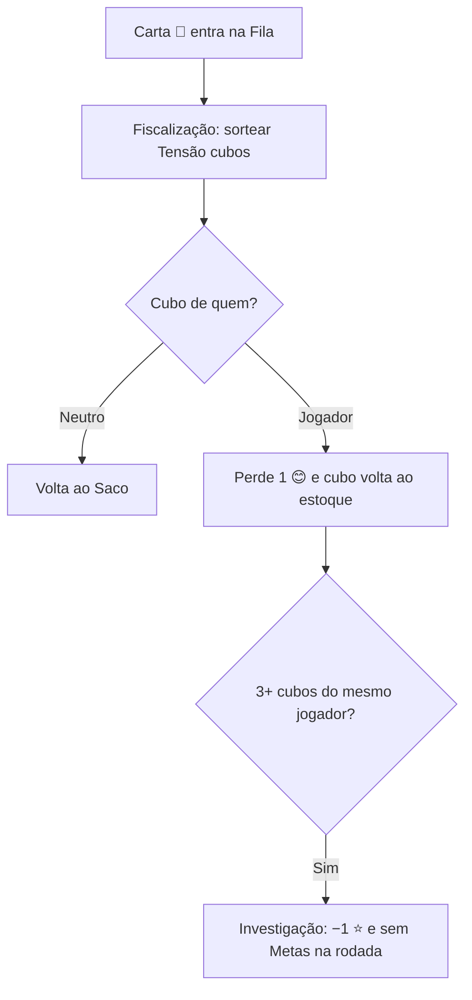

# 11 — Guia Visual (Direção de Arte)

> Objetivo: que **todas** as cartas, tabuleiros, tokens e a interface web pareçam do mesmo mundo. Este guia é a "régua" que você cola nos prompts de IA (`12`), no Figma/Canva e no CSS do site.

---

## 1. Conceito visual em uma frase

**"Relatório oficial de planejamento urbano dos anos 60, ilustrado como maquete de papel."**
Cores de gráfico impresso, formas simples, sombras suaves de miniatura (tilt-shift), tipografia de formulário público e uma pitada de **ironia burocrática** (carimbos, selos, clipes).

| Sim | Não |
|---|---|
| Vista **isométrica 3/4** para edifícios | Fotorrealismo, 3D "render" frio |
| Formas limpas, textura leve de papel | Excesso de detalhe e ruído |
| Paleta curta e consistente | Neon, gradientes arco-íris |
| Personagens **fictícios**, expressivos | Pessoas reais, celebridades, políticos reais |
| Humor sutil (carimbo, pasta, clipe) | Símbolos de partidos/países reais, bandeiras reais |
| Texto **sempre** colocado por você (não pela IA) | Texto gerado dentro da imagem |

---

## 2. Paleta

| | Nome | Hex | Uso |
|---|---|---|---|
| 🟫 | **Papel** | `#F3EBDD` | Fundo de cartas/tabuleiro, gutters nas folhas |
| 🟦 | **Azul Tinta** | `#1B2A41` | Texto, contornos, verso das cartas |
| 🟩 | **Verde Petróleo** | `#1F6F78` | Tecnocratas, INF, interface principal |
| 🟨 | **Mostarda** | `#E0A526` | Verba 💰, destaques, selos |
| 🟥 | **Tijolo** | `#C4533A` | Alertas 🔔, Suspeita, IND |
| 🌿 | **Sálvia** | `#8DAA7E` | Verdes, VER, sustentabilidade |
| 🟪 | **Ameixa** | `#6B3F69` | Intrigas, política, 🗳️ |
| ⬜ | **Névoa** | `#CFCABD` | Linhas secundárias, tiles vazios |

**Cores por Facção**

| Facção | Cor | Hex | Emblema (forma) |
|---|---|---|---|
| 🔧 Tecnocratas | Verde Petróleo | `#1F6F78` | Engrenagem + régua |
| 🌿 Verdes | Sálvia | `#8DAA7E` | Folha em círculo |
| 💼 Empresários | Mostarda | `#E0A526` | Pasta/moeda em losango |
| ✊ Sindicatos | Tijolo | `#C4533A` | Punho/ferramenta cruzada em hexágono |

**Cores por tipo de carta (faixa do título)**

| Tipo | Cor da faixa |
|---|---|
| Básica | Névoa `#CFCABD` |
| Padrão | Papel escuro `#E4D8BF` |
| Edificação | por Zona (abaixo) |
| Administração/Aliado | Azul Tinta |
| Decreto | Mostarda com borda dupla |
| Intriga | Ameixa |
| Obra-Prima | Dourado `#C9A227` com moldura ornamentada |
| Exploração | cor do terreno (seção 6) |
| Meta | Azul Tinta com selo ⭐ |
| Rodada | Papel com faixa dividida (Evento / Auditoria) |

**Cores por Zona (edificações)**

| Zona | Cor | Hex |
|---|---|---|
| RES | Amarelo-areia | `#E8C874` |
| COM | Azul-céu | `#5E9CC4` |
| IND | Tijolo | `#C4533A` |
| INF | Verde Petróleo | `#1F6F78` |
| VER | Sálvia | `#8DAA7E` |
| SER | Rosa-coral | `#E07A6B` |
| MON | Dourado | `#C9A227` |

> **Acessibilidade:** nunca use só cor. Cada Zona e Facção tem **forma/padrão próprio** (RES = casinha, COM = toldo, IND = chaminé, INF = raio/gota, VER = folha, SER = cruz neutra, MON = coroa/estrela). Use também texturas (listras, pontos) em modo daltônico.

---

## 3. Tipografia

| Uso | Fonte sugerida (Google Fonts) | Observação |
|---|---|---|
| Títulos de carta | **Archivo Narrow** / **Barlow Condensed** (Bold) | Condensada, estilo formulário |
| Texto de regras | **IBM Plex Sans** (Regular/Medium) | Legível em 8–9 pt impresso |
| Números e custos | **IBM Plex Mono** (Bold) | Alinhamento limpo |
| Carimbos/flavor | **Special Elite** (máquina de escrever) | Só em ornamentos e flavor text |

**Tamanhos (carta 63×88 mm):** título 11–12 pt · custo 14 pt · regras 8,5–9 pt · flavor 7,5 pt itálico · ID 6 pt.

---

## 4. Iconografia

Estilo: **ícones grossos, 2 cores, cantos arredondados, contorno 2 px Azul Tinta**. Cada ícone cabe num quadrado, legível em 6 mm.

| Ícone | Conceito | Forma |
|---|---|---|
| 💰 Verba | Moeda | Disco mostarda com furo quadrado |
| 🔨 Obra | Martelo + capacete | Martelo simples em Tijolo |
| 🗳️ Articulação | Urna/aperto de mão | Urna com envelope, Ameixa |
| ⭐ Mérito | Estrela de 5 pontas | Dourado com contorno |
| 🎖️ Selo | Selo de cera/carimbo | Carimbo circular |
| 😊 Aprovação | Rosto sorridente | Círculo mostarda |
| ☁️ Poluição | Nuvem cinza com fábrica | Cinza-chumbo |
| ⚡ Energia | Raio | Amarelo |
| 💧 Água | Gota | Azul-céu |
| 👥 População | Dois bustos | Azul Tinta |
| 🕵️ Suspeita | Olho/lupa | Tijolo (o cubo físico é da cor do jogador) |
| 🔔 Alerta | Sirene | Tijolo com ondas |

**Cubos físicos:** cubos de madeira 10 mm nas cores dos jogadores (6 cores), cubos neutros em **cinza-pedra**. **Marcadores** de Mérito/Aprovação: discos de madeira.

---

## 5. Anatomia da carta (63 × 88 mm)

```
┌──────────────────────────────┐
│ [Zona] NOME DA CARTA   [Aq]  │  ← faixa colorida (título + custo de aquisição)
│ [🔧]                         │  ← ícone de Facção (canto)
├──────────────────────────────┤
│                              │
│        ARTE (5:4)            │  ← janela de arte; elemento principal centrado
│                              │
├──────────────────────────────┤
│ Ob 🔨2 │ ⚡1 💧1 │ Req 👥4   │  ← faixa de stats (só em Edificação)
├──────────────────────────────┤
│  EFEITO / REGRAS             │
│  Renda 💰1; +💰1 por RES     │  ← ícones inline no texto
│  adjacente (máx. +2).        │
│                              │
│  “Flavor text opcional”      │
├──────────────────────────────┤
│ E1-02 · Tier I      🔔  ★    │  ← ID, tier, alerta, raridade
└──────────────────────────────┘
```

**Variações por tipo**
- **Edificação:** faixa de stats completa; moldura com **recorte de "tile"** (cantos chanfrados).
- **Administração/Aliado:** arte retrato (busto) e **crachá** com o cargo.
- **Decreto:** moldura de **documento com selo de cera** e furos de grampo na lateral.
- **Intriga:** moldura **noir** (envelope), fundo Ameixa; carimbo "EXILE" (ícone de fogo/papel rasgado).
- **Obra-Prima:** moldura dourada, **⭐2** grande no topo, custo triplo (💰🔨🗳️) em destaque.
- **Exploração:** formato **paisagem** opcional (5×3,5 cm cada, cartas pequenas) com tipo (Achado/Sítio/Risco/Encontro) no canto.
- **Meta:** arte em forma de **emblema**; faixa dupla "Ouro ⭐2 / Prata ⭐1".
- **Rodada:** carta dividida horizontalmente; topo = Evento (ilustração), base = Auditoria (ícone + regra).

### Tamanho e impressão

| Item | Valor |
|---|---|
| Tamanho final | **63 × 88 mm** (padrão poker/“standard”) |
| Sangria | 3 mm por lado → arquivo **69 × 94 mm** |
| Resolução | 300 dpi → **815 × 1110 px** |
| Cantos | Raio 3 mm |
| Zona segura | 4 mm para dentro do corte |
| Cartas Exploração (mini) | 44 × 63 mm (mini euro), 300 dpi → 520 × 744 px com sangria |
| Verso | 1 verso por deck (cores abaixo) |

**Versos:** Básico = Névoa com selo "PREFEITURA" · Padrão = Papel com engrenagem · Especial = Azul Tinta com ⭐ · Intrigas = Ameixa · Obras-Prima = Dourado · Exploração = cor do terreno · Metas = Azul Tinta/Mostarda · Rodada = Papel/Tijolo.

---

## 6. Mood de cada terreno (para ilustração e tabuleiro)

| Terreno | Paleta dominante | Atmosfera | Elementos recorrentes |
|---|---|---|---|
| 🌊 Litoral | Azul-céu `#5E9CC4`, areia `#E8C874`, coral | Dia de verão, ensolarado | Quiosques, guarda-sóis, gaivotas, píer |
| ⛰️ Montanha | Cinza-azulado `#6C7A89`, ocre, verde-pinho | Manhã com neblina | Teleférico, minas, encostas em degraus |
| 🌾 Planície | Verde-trigo `#B5C66E`, amarelo, céu amplo | Tarde dourada | Silos, moinhos de vento, estradas retas |
| 🏜️ Deserto | Laranja `#D98A3D`, rosa-terra, azul profundo | Sol a pino / fim de tarde | Dunas, painéis solares, oásis |
| 🌲 Floresta | Verde-musgo `#3E6B4B`, âmbar, neblina | Luz filtrada pelas copas | Troncos, trilhas, pousadas de madeira |
| 🏝️ Ilha | Turquesa `#2BB3A3`, coral, branco | Tropical, brisa | Balsas, resorts, recifes |

**Tabuleiro de terreno:** vista **de cima (top-down)** com 16 casas em grade 4x4, cantos arredondados, contornos 2 px Azul Tinta, casa vazia = Papel com tracejado; casas especiais (Orla, Encosta, Jazida, Rio, Duna, Oásis, Floresta) com **textura própria** e ícone no canto. Medidores (😊 trilha 0–10, Tesouro 0–5, Facções, ☁️/⚡/💧) numa **faixa lateral**.

---

## 7. Tabuleiro principal e tokens

- **Proporção:** painel 16:9 (ou 2 × A3 impressos) conforme `03 §1`.
- **Trilha de Mérito:** "régua" horizontal com marcos de Cargo (0–10) e **ícones de cargo** (pasta, cartola, bandeirinha neutra, medalha…).
- **Facções:** 4 trilhas verticais lado a lado, cada uma com cor e emblema, espaço do token de Aliança no topo.
- **Saco:** ilustração de uma **bolsa de pano** com carimbo "FISCALIZAÇÃO".
- **Selos:** fichas redondas Mostarda com carimbo.
- **Token de Primeiro Jogador:** **pasta de prefeito** (maleta) ou **chave da cidade**.

---

## 8. Interface web (tokens de design)

```css
:root {
  --paper:   #F3EBDD;
  --ink:     #1B2A41;
  --teal:    #1F6F78;
  --mustard: #E0A526;
  --brick:   #C4533A;
  --sage:    #8DAA7E;
  --plum:    #6B3F69;
  --mist:    #CFCABD;

  --zone-res: #E8C874; --zone-com: #5E9CC4; --zone-ind: #C4533A;
  --zone-inf: #1F6F78; --zone-ver: #8DAA7E; --zone-ser: #E07A6B; --zone-mon: #C9A227;

  --radius: 10px;
  --shadow: 0 2px 0 rgba(27,42,65,.25), 0 8px 16px rgba(27,42,65,.12);
  --font-title: "Archivo Narrow", "Barlow Condensed", sans-serif;
  --font-body:  "IBM Plex Sans", system-ui, sans-serif;
  --font-mono:  "IBM Plex Mono", ui-monospace, monospace;
}
```

**Componentes-chave:** `Card`, `Tile`, `ResourcePill`, `MeterBar`, `FactionTrack`, `BagWidget`, `RoundBanner`, `LogEntry`.
**Estados:** *hover* (levanta 4 px), *selecionável* (borda Mostarda), *inativo* (grayscale + tracejado), *alerta* (pulsa Tijolo).
**Animações:** cartas deslizam da mão à grade (250 ms); recursos sobem "+1" em Mostarda; **Fiscalização** = saco balança, cubos saem um a um (150 ms cada) com pausa dramática antes do último.

---

## 9. Fluxo visual do turno (diagrama)





---

## 10. Lista de assets (para produção)

| Grupo | Qtd | Formato |
|---|---|---|
| Cartas Básicas (4 tipos) | 4 artes | Arte 5:4 |
| Padrão (4 pilhas) | 4 | Arte 5:4 |
| Edificações Especiais | 24 | Arte 5:4 (isométrica) |
| Administração/Aliados | 20 | Retrato 4:5 |
| Decretos | 6 | Objeto/documento |
| Intrigas | 10 | Cena noir |
| Obras-Prima | 12 | Arte 5:4 com moldura dourada |
| Regionais (3 por terreno) | 18 | Arte 5:4 |
| Exploração | 60 | Arte 3:2 |
| Metas | 18 | Emblema 1:1 |
| Rodada | 12 | Cena 3:2 |
| Facções | 4 emblemas | Vetor |
| Ícones | 12 | Vetor SVG |
| Tabuleiros de terreno | 6 | Top-down 1:1 |
| Tabuleiro principal | 1 | 16:9 |
| Versos | 8 | 63×88 mm |

**Convenção de nomes:** `E1-02_mercadinho_art.png`, `A2-04_mestre-de-obras_art.png`, `X-LIT-03_farol_art.png`, `G-05_bairro-planejado_art.png`, `RD-07_visita-ministro_art.png`. Mantenha o **ID da carta no nome**; o compositor lê o ID para buscar o texto.
